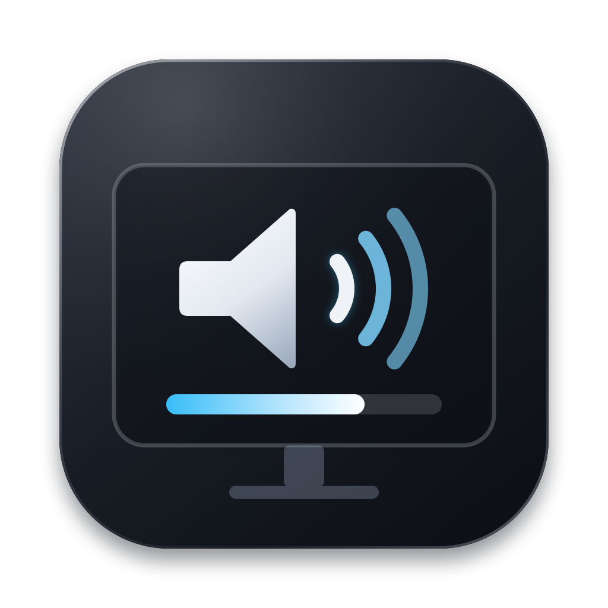
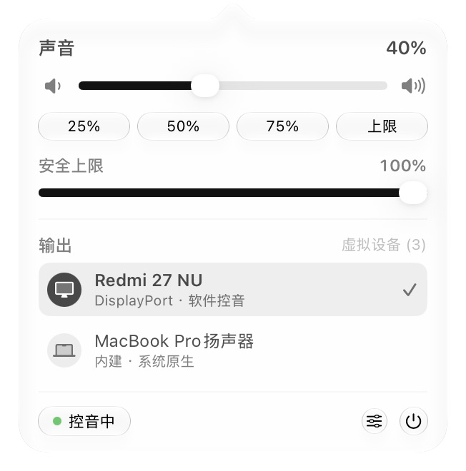

<div align="center">
  
  <h1>DisplayVolume</h1>
  <p>
    <strong>Native macOS volume &amp; Magic Keyboard control for external DisplayPort &amp; HDMI speakers.</strong><br />
    Zero virtual kexts. Zero 100% startup blasts. Liquid Glass menu bar popover &amp; floating OSD.
  </p>

  <p>
    
    
    
    <a href="./LICENSE"></a>
  </p>

  <p>
    <strong>English</strong> · <a href="./README.zh-CN.md">简体中文</a>
  </p>
</div>

---

## Why DisplayVolume?

macOS locks system volume sliders and keyboard volume keys (`F10` / `F11` / `F12`) for digital **DisplayPort, HDMI, and Thunderbolt** audio outputs, showing a disabled `⊘` bezel whenever you press volume keys on a **Magic Keyboard** or MacBook. Many monitors also ignore DDC/CI audio commands over USB-C / DisplayPort.

**DisplayVolume** fixes this from first principles without installing kernel extensions or virtual audio drivers:

- **Native Keyboard Volume Keys (`F10` / `F11` / `F12`)**: Intercepts media keys via a dedicated, lock-free `CGEventTap` thread only while a volume-locked external monitor is active—suppressing the `⊘` disabled icon and displaying a sleek top-right **Liquid Glass Volume OSD**.
- **Automatic Native Pass-Through**: Switch to AirPods, Bluetooth headphones, or MacBook Pro Speakers and DisplayVolume immediately yields the CoreAudio tap and passes hardware volume keys straight back to macOS.
- **Persistent Background Engine (`KeepAlive` LaunchAgent)**: Closing or hiding the menu bar UI never causes a sudden 100% hardware volume blast. Volume limits stay active across UI quits, sleep/wake, and reboots.
- **Zero-Delay Wake & Startup Protection**: Once system audio capture is authorized, attenuation engages synchronously before the first audio frame plays—eliminating the 200ms full-volume pop on reconnect or wake.
- **Safety Volume Ceiling (`上限`)**: Directly visible slider to cap maximum output (e.g. `80%`) so accidental clicks or held keyboard keys never exceed a comfortable level.
- **10ms Click-Free C17 DSP**: Supports 1–8 channel interleaved and planar `Float32` PCM streams with a quadratic perceptual taper and sample-accurate linear ramping.

---

## Visual Overview

<p align="center">
  
</p>

- **Direct Native Controls**: Click the distinct monitor-speaker menu bar icon to adjust volume via a click-to-jump native `NSSlider`, quick presets (`25%`, `50%`, `75%`, `Max`), directly exposed safety ceiling slider, and one-click output device list—zero nested drawers.
- **Scroll Wheel Control**: Hover over the menu bar icon and scroll up/down to nudge volume in 2% steps without opening the popover.
- **Fine & Fallback Shortcuts**:
  - `F10` / `F11` / `F12` (Magic Keyboard & MacBook): Mute / Volume Down / Volume Up (`±5%`)
  - `⇧ + ⌥ + Volume Up / Down`: Fine-grained micro-steps (`±1%`)
  - `⌥ + Volume`: Passes through to macOS Sound Settings
  - `⌃ + ⌥ + ↑ / ↓ / M`: Fallback global hotkeys

---

## Architecture

DisplayVolume uses two focused processes packaged inside one self-contained `DisplayVolume.app`:

1. **`DisplayVolumeEngine.app` (`Contents/Helpers/`)**:
   - Event-driven CoreAudio property listeners (`kAudioHardwarePropertyDefaultOutputDevice`, `kAudioDevicePropertyDeviceIsAlive`, `kAudioStreamPropertyVirtualFormat`) with 0% idle polling when yielded to native speakers/headphones.
   - `CATapDescription` process tap + private aggregate device routed through `AudioGain.c` (C17 lock-free atomic gain & 10ms ramp).
   - Thread-isolated `CGEventTap` (`MediaKeyTap.swift`) with timeout auto-recovery and non-activating `VolumeOSD` panel.
2. **`DisplayVolume.app`**:
   - Lightweight `LSUIElement` menu bar controller (`NSStatusItem` + `NSPopover`) with per-device profiles, output switcher, and automatic `LaunchAgent` provisioning (`~/Library/LaunchAgents/com.hazelkahlil.DisplayVolume.Engine.plist`).

---

## Build & Install from Source

Requires **macOS 14.4+** and Xcode Command Line Tools (`swift` & `clang`).

```bash
git clone https://github.com/HazelKahlil/DisplayVolume.git
cd DisplayVolume
./Scripts/build.sh --install
open ~/Applications/DisplayVolume.app
```

To create a drag-to-Applications `.dmg` installer:

```bash
./Scripts/package_dmg.sh
```

To completely stop the background engine and uninstall:

```bash
./Scripts/uninstall.sh
```

---

## Permissions

1. **System Audio Recording Only (`DisplayVolume Engine`)**: Required once by Apple's `CATapDescription` API to attenuate playback audio on-device before it reaches your monitor.
2. **Accessibility (`DisplayVolume`)** *(optional, required for Magic Keyboard `F10–F12`)*: Required by macOS to intercept and suppress the system `⊘` volume bezel when pressing hardware media keys. Click **Allow** in the compact popover bar to open System Settings directly.

> Tip: `Scripts/build.sh` automatically signs with your local `Apple Development` certificate if available so macOS preserves permissions across rebuilds (set `DISPLAYVOLUME_ADHOC_SIGN=1` to force ad-hoc signing).

---

## License

[MIT License](./LICENSE) © 2026 Hazel Kahlil
