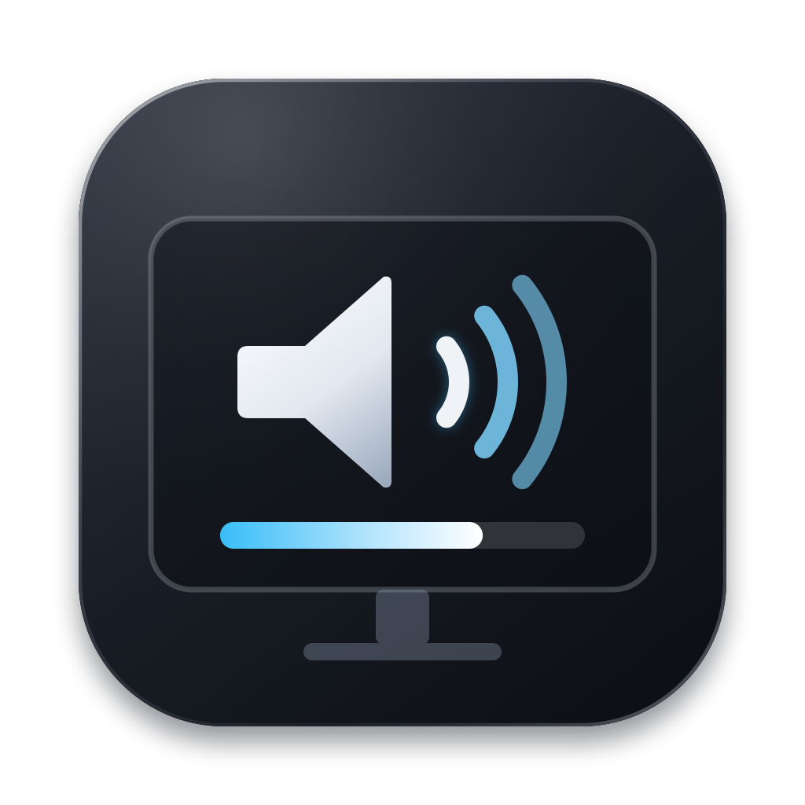
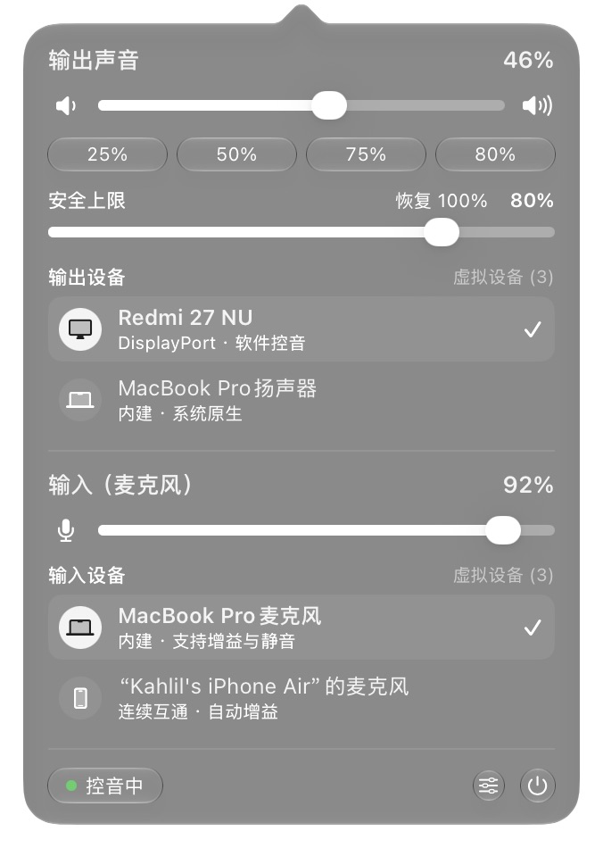

<div align="center">
  
  <h1>桌面音量 · DisplayVolume</h1>
  <p>
    <strong>面向外接显示器音箱与 Mac 全音频输入输出（含麦克风）的原生 macOS 音量控制工具</strong><br />
    无需虚拟声卡 · 零麦克风隐私黄点 · 原生 Liquid Glass 面板与右上角浮窗
  </p>

  <p>
    
    <a href="https://github.com/HazelKahlil/DisplayVolume/actions/workflows/ci.yml"></a>
    
    
    
    <a href="./LICENSE"></a>
  </p>

  <p>
    <a href="./README.md">English</a> · <strong>简体中文</strong>
  </p>
</div>

---

## 为什么做这个工具？

当 Mac 通过 **DisplayPort、HDMI 或 Thunderbolt** 连接外接显示器（例如 Redmi 27 NU 等接入音箱的显示器）时，macOS 会把系统声音输出滑块锁死在 `100%`。每次在 **Magic Keyboard（妙控键盘）** 或 MacBook 上按 `F10` / `F11` / `F12` 调节音量，屏幕只会弹出一个禁止调节的 `⊘` 图标，很多显示器也不支持通过 DDC/CI 调节音量。

**桌面音量 (DisplayVolume)** 从第一性原理出发，不安装任何虚拟声卡或内核扩展，直接基于 macOS 原生 `CATapDescription` 音频流拦截与 C17 实时 DSP 解决这一问题：

- **直接支持妙控键盘 / MacBook 音量键 (`F10` / `F11` / `F12`)**：通过独立高优先级线程上的 `CGEventTap` 接管音量键与静音键，吞掉系统的 `⊘` 禁用提示，并在屏幕右上角显示纯净的原生 Liquid Glass 浮窗（OSD）。
- **完整音频输入 + 输出一体化控制**：同时支持外接锁音显示器（CoreAudio Process Tap 软件控音）、内建扬声器 / AirPods 等原生硬件输出（直写 CoreAudio HAL），以及 **Mac 麦克风输入控制**（输入设备切换、实时输入增益滑块、硬件静音及 USB 麦克风软静音回退、全局 `⌃⌥⇧ M` 一键闭麦与右上角麦克风浮窗）。
- **零麦克风隐私黄点、零蓝牙降质**：麦克风控制仅读写 CoreAudio HAL 设备属性，绝不打开音频采集流——不会点亮菜单栏橙色录音指示灯，也不会导致 AirPods 从高清 A2DP 跌落至通话 HFP 音质，无需额外麦克风权限弹窗。
- **独立后台守护，关闭界面依然持久生效**：退出菜单栏界面不会让声音突然恢复 100% 爆音；重连显示器、熄屏唤醒或重启登录后自动无缝恢复。
- **首帧零爆音保护**：音频权限验证通过后，软件衰减会在第一帧声音送出前同步启用，消除重连/唤醒瞬间的 200ms 高音量冲击。
- **全部平铺直出**：输出音量滑块（轨道任意点击直达 + 零跳变拖动）、安全上限滑块、输出设备列表、麦克风增益/静音与输入设备列表全部直接展示，无需层层展开。
- **10ms 无爆音 C17 实时增益**：支持 1–8 声道交错与平面 `Float32` PCM 音频流，采用二次方听感曲线与逐采样线性平滑渐变。

---

## 界面与交互

<p align="center">
  
</p>

- **原生 Liquid Glass 面板**：菜单栏采用独立显示器音浪图标（与系统自带喇叭清晰区分），左键打开输入输出一体化面板，右键可一键静音输出或静音麦克风。
- **滚轮悬停调音**：鼠标悬停在菜单栏图标上直接上下滚动，无需点开面板即可按 `2%` 步进微调音量（外接显示器与原生扬声器均支持）。
- **快捷键一览**：
  - `F10` / `F11` / `F12`（妙控键盘 / Mac 键盘）：静音 / 降低 / 提高音量（`±5%`）
  - `⇧ + ⌥ + 音量加减`：`±1%` 精细微调
  - `⌥ + 音量键`：原生放行，直接打开系统声音设置
  - `⌃ + ⌥ + ↑ / ↓ / M`：备选全局输出快捷键
  - `⌃ + ⌥ + ⇧ + M`：全局麦克风静音/开麦切换（任意输出设备均可用，附右上角浮窗提示）

---

## 从源码构建与安装

需要 **macOS 14.4+** 与 Xcode 命令行工具（`swift` 与 `clang`）：

```bash
git clone https://github.com/HazelKahlil/DisplayVolume.git
cd DisplayVolume
./Scripts/verify.sh --install
open ~/Applications/DisplayVolume.app
```

> 项目工程规范、防回归自动化门禁、项目专属 Skill 与第一性原理复盘报告详见 [`AGENTS.md`](./AGENTS.md)、[`Scripts/verify.sh`](./Scripts/verify.sh)、[`.agents/skills/displayvolume-engineering/SKILL.md`](./.agents/skills/displayvolume-engineering/SKILL.md) 与 [`docs/RETROSPECTIVE-2026-11.md`](./docs/RETROSPECTIVE-2026-11.md)。

打包可拖拽安装的 `.dmg`：

```bash
./Scripts/package_dmg.sh
```

彻底停用后台服务并卸载：

```bash
./Scripts/uninstall.sh
```

---

## 权限说明

1. **录屏与系统录音（`桌面音量后台`）**：macOS `CATapDescription` 要求此权限以在声音送往显示器前进行本地实时缩放；音频仅在内存内实时处理，绝不录音或上传。
2. **辅助功能（`桌面音量`）**：用于接管 `F10–F12` 键盘音量键并隐藏系统的 `⊘` 禁止图标；授权一次后无需重启立即生效。

> 构建脚本默认优先使用本机 `Apple Development` 证书签名，避免每次更新后重新弹窗授权；开源贡献者无本地证书时会自动回退到 ad-hoc 签名（也可通过 `DISPLAYVOLUME_ADHOC_SIGN=1` 强制使用）。

---

## 开源协议

[MIT License](./LICENSE) © 2026 Hazel Kahlil
